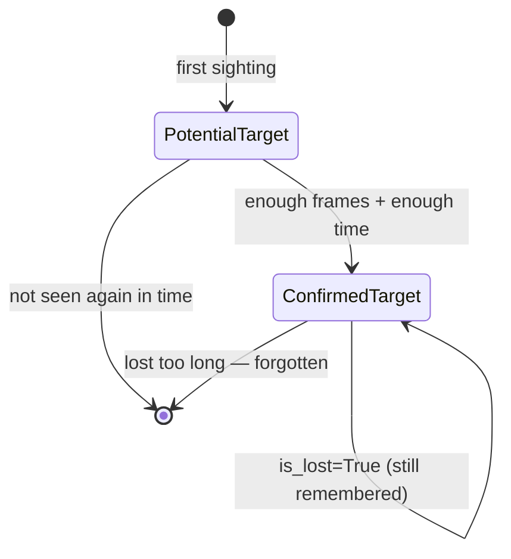

# `targets.py` — The Shape of "One Object, Over Time"

## Three types, one lifecycle

This module holds no logic — just data shapes — but the shapes encode a real
design decision: an object's journey through the tracker has exactly two
states, modeled as two distinct classes rather than one class with a status
flag.

- **`Observation`** — a `NamedTuple`, not a stored/mutated entity: one
  detection, in map-frame `xyz`, with its label, the frame it came from, and
  optionally a detector track ID and a `SizeEstimate`. This is what flows
  *into* `WorldTracker.update()`; it never lives inside a target.
- **`PotentialTarget`** — an object that's been seen, but not enough times
  yet to trust. Accumulates `observation_count`, a running position, and (if
  size estimation is active) a running size mean/variance via Welford's
  method (see `size_m2`/`size_n` below).
- **`ConfirmedTarget`** — a `PotentialTarget` that crossed the promotion
  threshold (`world_tracker.WorldTracker.promote()`). It carries everything
  `PotentialTarget` does, plus the fields that only make sense once an
  object is trusted: convergence tracking, an optional appearance
  embedding, and the `is_lost` flag that lets a target survive a temporary
  visibility gap instead of being deleted outright.

## Why two classes instead of one with a `confirmed: bool` flag

The alternative design — one `Target` dataclass with a boolean — would work,
but it would mean every `ConfirmedTarget`-only field (`pos_welford_mean`,
`is_converged`, `embedding`, `is_lost`) exists on every `PotentialTarget`
too, either uninitialized or defaulted to a value that's meaningless until
confirmation happens. Splitting the types means a `PotentialTarget` simply
*cannot* have a stale `is_converged` value, because the field doesn't exist
on it — the type system enforces a lifecycle invariant that a boolean flag
would only enforce by convention.

The cost of the split shows up in `world_tracker.py`'s `promote()`: moving an
object from potential to confirmed status means constructing a *new*
`ConfirmedTarget` from the old `PotentialTarget`'s fields, field by field,
rather than just flipping a flag in place. `WorldTracker.update_target()`
also has to `isinstance(target, ConfirmedTarget)` check before doing
confirmed-only work (Welford position variance) — the price of the
type-level guarantee is a little more code at the one seam where an object
crosses from one type to the other.

## Two independent Welford accumulators

Both target types carry `size_mean` / `size_m2` / `size_n` — a running mean
and sum-of-squared-deviations for object *size*, updated via
[Welford's online algorithm](https://en.wikipedia.org/wiki/Algorithms_for_calculating_variance#Welford's_online_algorithm)
(see `world_tracker.welford_update_size`). `ConfirmedTarget` additionally
carries `pos_m2` / `pos_n` / `pos_welford_mean` / `position_variance` /
`is_converged` — the *same* Welford technique applied to *position* instead
of size, but only for confirmed targets (a potential target's position isn't
trusted enough yet to be worth a variance estimate). These are genuinely two
separate running statistics computed with the same numerically-stable
algorithm, not one generalized mechanism — worth not conflating when reading
`world_tracker.py`.

## `embedding: np.ndarray | None = field(default=None, compare=False)`

The `compare=False` on this field is a small but easy-to-miss detail: it
excludes `embedding` from the dataclass's auto-generated `__eq__`. Two
`ConfirmedTarget` instances with identical position/label/counts but
different embedding arrays compare equal — which matters because numpy
arrays don't support the `==` operator the way `dataclass.__eq__` expects
(comparing two arrays with `==` produces an elementwise array, not a single
bool, which would break equality checks entirely rather than just being
imprecise about it).

## Observations

- **`track_ids` is a `set`, not a `list`** — a target can accumulate several
  detector-side track IDs over its life (the detector's own tracker resets
  IDs on brief occlusion; several IDs can legitimately point at one
  world-frame object), and set membership (`obs.track_id in t.track_ids`,
  used throughout `association.py`) is the operation actually needed, not
  ordering.
- **`position_history` is a plain list of `(timestamp_s, xyz)` tuples**,
  trimmed by `world_tracker.trim_pos_history` to a rolling window
  (`stationary_window_s`) — this module doesn't enforce that trimming
  itself; a `targets.py`-only unit test could construct a `ConfirmedTarget`
  with an arbitrarily long, untrimmed history without complaint, since the
  invariant lives in `world_tracker.py`, not here.
- **Nothing in this file validates cross-field consistency** (e.g. that
  `observation_count` roughly matches `len(position_history)` before
  trimming) — these are plain data containers; every invariant about how
  their fields relate to each other is enforced by `WorldTracker`, not by
  the dataclasses themselves.
