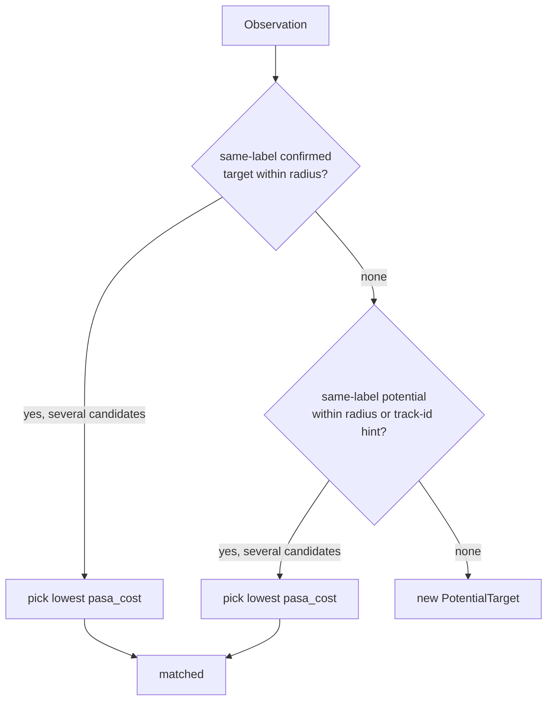

# `association.py` — Deciding "Is This the Same Object I Already Know About?"

## The core question, and why it's hard

Every observation `WorldTracker` receives has to be matched against
everything already tracked, or recognized as genuinely new. Get this wrong
in one direction (too permissive) and two different cups become one target
that jumps around implausibly. Get it wrong in the other (too strict) and
one cup, drifting slightly with odometry noise between sightings, becomes
five different "new" targets. `TargetAssociator` is where that trade-off is
made — and it's made twice, via two independent strategies sharing one
public entry point.

```python
def find_match(self, obs: Observation, confirmed: list, potentials: list):
    if self.config.use_class_profiles:
        return self.find_match_pasa(obs, confirmed, potentials)
    return self.find_match_baseline(obs, confirmed, potentials)
```

`find_match_baseline` — distance and a fixed radius, nothing else.
`find_match_pasa` (F38, Profile-Aware Spatial Association) — a weighted cost
function combining distance, size consistency, motion-plausibility, and
detector track-ID continuity, with per-class radius overrides from
`class_profiles.py`. Everything below explains both, and why the more
complex one exists.

## Baseline: confirmed targets get first refusal, then a wider net for new ones

```python
def find_match_baseline(self, obs, confirmed, potentials):
    strict = self.config.max_assoc_dist_m
    confirmed_dist = strict * self.config.confirmed_assoc_mult
    ...  # nearest same-label confirmed target within confirmed_dist wins, if any
    ...  # else: nearest same-label potential within strict (or 2x strict with a track-id hint)
```

Two radii, not one, and they're checked in a specific order:

1. **Confirmed targets first, at the *wider* radius** (`confirmed_dist =
   strict * confirmed_assoc_mult`, default 2x). A confirmed target has
   already proven itself over several sightings — it's earned the benefit
   of the doubt that a bit of accumulated odometry drift since its last
   observation is still "the same object," not a coincidence.
2. **Potentials second, at the *tighter* radius** (`strict`) — unless the
   observation's `track_id` matches a track ID the potential has already
   seen, in which case the radius doubles. A brand-new, unproven target
   hasn't earned that trust yet; a detector-side track-ID match is treated
   as strong enough independent evidence to extend it anyway.

Checking confirmed targets before potentials (rather than nearest-overall)
means a confirmed target always wins a contested observation over a nearby
potential, even if the potential happens to be geometrically closer — a
confirmed identity is trusted more than an unconfirmed guess.

## PASA: the same two-tier structure, replacing distance with a weighted cost



The structural shape — confirmed-first, wider radius, track-ID hint for
potentials — is identical to baseline. What changes is *how the best
candidate is chosen* once the radius has narrowed the field: instead of
"nearest wins," it's "lowest weighted cost wins."

```python
def pasa_cost(self, obs, target) -> float:
    return (
        cfg.assoc_cost_distance_weight * components["dist_norm"]
        + cfg.assoc_cost_size_weight * components["size_norm"]
        + cfg.assoc_cost_stationary_weight * components["stat"]
        - cfg.assoc_cost_track_hint_weight * components["hint"]
    )
```

Four independent signals, each normalized to a comparable scale before
weighting:

- **`dist_norm`** — Euclidean distance divided by `max_assoc_dist_m`, so a
  distance-only cost is dimensionless and roughly `0..1` within the expected
  association range (baseline association, in other words, is what you get
  if every weight except distance is zero).
- **`size_norm`** — how far the observation's estimated width deviates from
  the candidate's running size mean, normalized either by the class
  profile's `diameter_range_m` span (if a profile exists) or by the
  candidate's own size (fallback). Only computed when
  `assoc_cost_size_weight > 0` *and* the observation's depth quality clears
  `size_confidence_floor` — a noisy or absent size reading contributes
  nothing rather than a misleadingly large cost.
- **`stat`** (stationarity) — `0.0` if the candidate's recent position
  history looks stationary (per the class's `max_stationary_speed_mps`),
  `1.0` if it looks like it's actually moving, `0.5` (neutral) if there
  isn't enough history yet to judge. This rewards matching an observation to
  a target whose behavior is consistent with what its class predicts.
- **`hint`** — `1.0` if the observation's detector track ID is already known
  to the candidate, `0.0` otherwise. Note the minus sign in `pasa_cost`: this
  is the one term that *reduces* cost (makes a match more attractive), not
  one that adds to it — a track-ID match is evidence *for* the match, so it
  should lower the barrier to choosing that candidate, unlike the other
  three terms which are all measures of how implausible the match looks.

`pasa_cost_breakdown` exposes the same four weighted components as a
labeled dict instead of a single float — this is what feeds
`/targets/assoc_diag` (see `13-semantic_map_node.md`) so a person tuning the
weights can see *why* a particular match was chosen, not just that it was.

## Recovering from a false split

```python
def find_false_split(self, obs, confirmed, timestamp_s):
    """Return the lost confirmed target this observation should recover, or None."""
```

A confirmed target that's briefly out of frame (camera pans away,
occlusion) gets marked `is_lost` (see `world_tracker.expire()`) rather than
deleted immediately. If it reappears before `false_split_lookback_s`
elapses, close to where it was last seen, and — if size data is available —
still a plausible size match (`size_check_fails` rejects a same-position,
wildly-different-size "recovery," which would more likely be a genuinely
different object that happens to be nearby), `find_false_split` reattaches
the new observation to the *original* target identity instead of letting it
spawn a brand-new `PotentialTarget` that has to re-earn confirmation from
scratch. `WorldTracker.update()` calls this *before* normal association, so
a successful recovery consumes the observation and it never reaches
`associate()` at all.

## Observations

- **The two association strategies don't share a cost model, only a radius
  structure.** `find_match_baseline` is genuinely "nearest wins"; there's no
  code path where baseline association considers size or motion. Reading
  `find_match_pasa` doesn't tell you anything about how `find_match_baseline`
  behaves beyond the shared two-tier radius shape.
- **`is_stationary` returning `False` for fewer than 2 history points** (not
  "unknown") means a brand-new target with only one recorded position is
  always scored as "not stationary" by `is_stationary` directly — but
  `stationarity_cost` special-cases `len(history) < 2` to return the neutral
  `0.5` *before* calling `is_stationary`, so that harsher "not stationary"
  verdict never actually reaches the cost function. Easy to misread if you
  only look at one of the two functions.
- **`euclidean` is duplicated conceptually with `map_rebasing`'s planar
  math** — this one is full 3D (`(a[0]-b[0])**2 + ... + (a[2]-b[2])**2`),
  used for association distance; `map_rebasing.py`'s transforms are
  deliberately planar-only (x, y, yaw). Different problems, coincidentally
  similar-looking formulas — not a DRY violation, since 3D distance and a
  planar SE(2) transform aren't the same operation.
