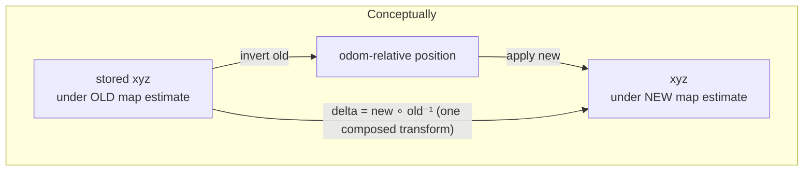

# `map_rebasing.py` — Keeping the Map Consistent When SLAM Changes Its Mind

## The problem in one sentence

A SLAM system doesn't hold `map → odom` fixed — it revises that estimate
whenever it gets new evidence (a loop closure, a better scan match), and
when it revises it, everything already recorded in the `map` frame based on
the *old* estimate needs the same correction applied, or it silently drifts
out of alignment with everything recorded *after* the correction.

This module is pure math with no ROS or `dome_semantic` imports — it didn't
exist anywhere in this codebase before F33 T03 (the module header is
explicit: *"No prior implementation existed anywhere in this codebase"*).
The earlier `dome_vision_ros` semantic-map node recorded everything in
`odom`, which never gets corrected by SLAM — so this problem, and this
module, simply didn't exist until the frame of record moved to `map` (F33
G1).

## SE(2): the right amount of geometry for a ground robot

Every transform here is a **planar rigid-body transform** — a 2D rotation
plus a 2D translation, `(x, y, yaw)` — not a full 3D transform. This is the
mathematical group [SE(2)](https://en.wikipedia.org/wiki/Euclidean_group)
(the "special Euclidean group" in two dimensions), and it's the right
amount of generality here for a specific physical reason stated in the
header comment: *"SLAM corrections on a ground robot are planar; z is left
untouched."* A wheeled robot doesn't get corrected in height — `z` is simply
copied through unchanged in `rebase_xyz`.

```python
@dataclass(frozen=True)
class PlanarTransform:
    x: float
    y: float
    yaw: float  # radians
```

Four operations on this one type cover everything the module needs:

```python
def apply_transform(t, xy) -> tuple:      # rotate then translate: t(xy)
def invert_transform(t) -> PlanarTransform:  # t such that t(t⁻¹(p)) == p
def compose_transforms(second, first) -> PlanarTransform:  # "first then second"
```

These three are the standard closed-form SE(2) group operations — apply,
inverse, and composition — implemented directly rather than through a
general-purpose transform library, because exactly these three operations
(and nothing more general) are what re-basing needs.

## The actual re-basing computation

```python
def rebase_delta(old_map_t_odom, new_map_t_odom) -> PlanarTransform:
    """The transform mapping an old-map-frame point to its new-map-frame position."""
    return compose_transforms(new_map_t_odom, invert_transform(old_map_t_odom))
```

This line is the crux of the whole module, worth working through carefully.
A stored target's position was recorded using the *old* `map → odom`
estimate. To find out where that same physical point sits under the *new*
estimate:

1. **Undo the old transform** (`invert_transform(old_map_t_odom)`) — this
   conceptually asks "what would this map-frame point look like relative to
   `odom`, under the assumption that was true when it was recorded?"
2. **Apply the new transform** (`compose_transforms(new_map_t_odom, ...)`)
   — re-express that same odom-relative relationship under the *corrected*
   `map → odom` estimate.

The net effect, `delta = new ∘ old⁻¹`, is a single combined transform that
maps directly from "position under the old map estimate" to "position under
the new one" — `rebase_xyz` and `rebase_tracker` apply this one `delta` to
every stored point, without needing to know or reconstruct `odom`-frame
coordinates at all.



## Deciding *when* to re-base: a hysteresis threshold, not every tick

```python
def has_jumped(old, new, epsilon_m=0.05, epsilon_rad=0.02) -> bool:
    return (
        abs(old.x - new.x) > epsilon_m
        or abs(old.y - new.y) > epsilon_m
        or abs(_angle_diff(old.yaw, new.yaw)) > epsilon_rad
    )
```

`map → odom` isn't perfectly static even without a discrete "jump" — tiny
continuous corrections happen too. Re-basing on every sub-millimeter wobble
would mean constantly rewriting every stored target's position for no
practical benefit and needless floating-point churn. The epsilon thresholds
(5 cm, ~1.1°) draw a line between "this is normal SLAM noise, ignore it" and
"this is a real correction (e.g. a loop closure), propagate it" —
`semantic_map_node.maybe_rebase` calls this once per detection callback and
only pays the re-basing cost when it actually fires.

`_angle_diff` handles the wraparound a naive `new.yaw - old.yaw` would get
wrong near ±π (e.g. old=179°, new=-179° is a 2° turn, not a 358° one):

```python
def _angle_diff(a: float, b: float) -> float:
    return (b - a + math.pi) % (2.0 * math.pi) - math.pi
```

## `rebase_tracker`: touching every stored point, not just the current one

```python
def rebase_tracker(tracker, delta: PlanarTransform) -> None:
    for t in list(tracker.confirmed_targets) + list(tracker.potential_targets):
        t.xyz_world = rebase_xyz(delta, t.xyz_world)
        t.position_history = [
            (ts, rebase_xyz(delta, xyz)) for ts, xyz in t.position_history
        ]
        if hasattr(t, "pos_welford_mean"):
            t.pos_welford_mean = rebase_xyz(delta, t.pos_welford_mean)
```

Three things get corrected per target, not one: the current position, the
*entire* `position_history` (used elsewhere for stationarity checks —
history entries need to stay internally consistent with each other and with
the current position after a correction), and — only for confirmed targets,
guarded by `hasattr` rather than an `isinstance` check — the running Welford
position mean. The `hasattr` guard is what lets this one function iterate
over both `PotentialTarget` and `ConfirmedTarget` instances (a mixed list)
without importing either type or branching on which one it's looking at;
`position_variance` itself is *not* re-based, because variance is a measure
of spread, and rotating/translating a set of points doesn't change how
spread out they are relative to each other.

## Observations

- **This module has zero ROS or `dome_semantic` imports** — genuinely
  standalone SE(2) math, testable (and tested, in `test_map_rebasing.py`)
  with no mocking at all. It's a strong candidate for extraction into a
  shared geometry utility if another ROS package in this workspace ever
  needs planar rigid-body transform composition.
- **`rebase_tracker` mutates targets in place** rather than returning new
  ones — consistent with `WorldTracker`'s general style (`update_target`,
  `welford_update_position`, etc. all mutate in place too), but worth
  knowing if `PotentialTarget`/`ConfirmedTarget` were ever made frozen for
  some other reason — this function would break.
- **No re-basing of `size_mean`/`size_m2`** is needed or attempted — size is
  rotation/translation-invariant, so there's nothing to correct there;
  omission, not oversight.
