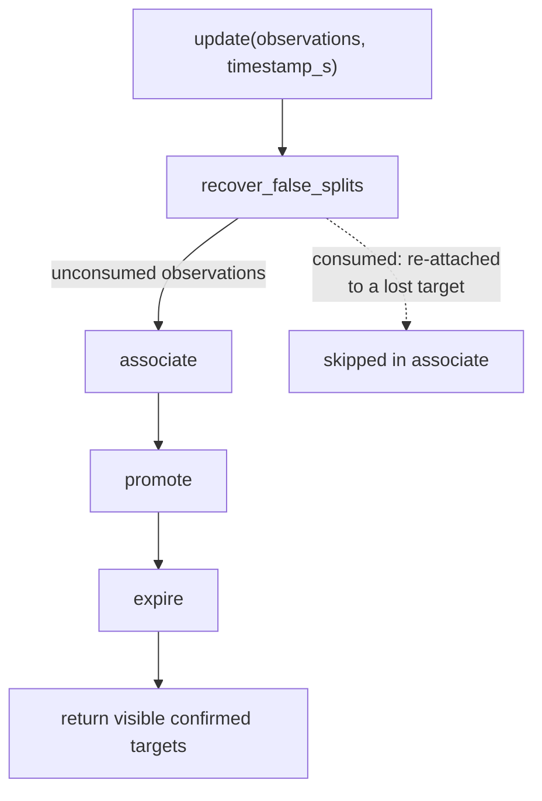

# `world_tracker.py` — The State Machine That Turns Noisy Sightings Into Facts

## The central idea

`WorldTracker` is the heart of the package: everything else in
`dome_semantic` either feeds it (`tf_adapter`, `map_rebasing`) or is fed by
its config (`tracker_config`, `class_profiles`) or is a helper it delegates
to (`association`, `embedding_similarity`, `size_estimate`). Its job is
deceptively simple to state and genuinely non-trivial to get right: **turn a
stream of noisy, momentary detections into a small set of stable, confirmed
facts about where objects are** — surviving detector noise, brief occlusion,
sensor track-ID resets, and (via `map_rebasing`, applied externally by
`SemanticMapNode`) SLAM corrections.

## One update, four phases, always in this order

```python
def update(self, observations: list, timestamp_s: float) -> list[ConfirmedTarget]:
    self.assoc_log = []
    remaining = self.recover_false_splits(observations, timestamp_s)
    self.associate(remaining, timestamp_s)
    self.promote(remaining, timestamp_s)
    self.expire(timestamp_s)
    return [t for t in self.confirmed if not t.is_lost]
```

This is the entire public contract most callers need: hand it a batch of
observations for one frame and the current time, get back the currently
visible confirmed targets. The four phases run in a specific, load-bearing
order:



- **`recover_false_splits` first** — before any new-target logic runs, give
  every observation a chance to reconnect with a target that recently went
  lost (see `association.find_false_split`). An observation that's recovered
  this way is removed from the list before `associate` ever sees it, so it
  can't *also* be matched to some other target or spawn a spurious new one.
- **`associate` second** — match each remaining observation to an existing
  target (confirmed or potential) or spawn a new `PotentialTarget`.
- **`promote` third** — check which potentials have earned confirmation
  *this frame's* observations, then move them from `self.potentials` to
  `self.confirmed`.
- **`expire` last** — after all this frame's updates are applied, sweep for
  targets that have gone quiet too long (mark lost) or too-long-lost (remove
  entirely).

Running `expire` last, not first, matters: a target observed *this frame*
should never be expired for having been unseen, even if its `last_seen_s`
from before this update would otherwise have crossed the timeout — updating
`last_seen_s` in `associate`/`promote` before `expire` runs is what prevents
that.

## Association: the anchor-gate detail worth understanding

```python
def promote(self, observations, timestamp_s):
    obs_labels = {self.to_obs(o).label for o in observations}
    confirmed_this_frame = {
        t.label for t in self.confirmed if t.label in obs_labels and not t.is_lost
    }
    ready = [
        p
        for p in self.potentials
        if p.observation_count >= self.config.min_frames
        and (p.last_seen_s - p.first_seen_s) >= self.config.min_time_s
    ]
    for p in ready:
        if (
            self.config.require_anchor
            and self.has_confirmed
            and not confirmed_this_frame
        ):
            continue
        ...
```

`require_anchor` (off by default) is a stricter promotion rule: a new
potential only gets promoted if *some already-confirmed target* was
co-observed in the same frame. The intent — stated in the inline comment —
is guarding against spurious confirmations far from any known landmark,
useful when odometry drift is a real concern (a confirmed anchor nearby is
some evidence the local map alignment is trustworthy right now). The
`self.has_confirmed` check exists specifically to **exempt the very first
confirmation**: `has_confirmed` starts `False` and there's no anchor to
require before *anything* has ever been confirmed, so the gate would
otherwise make the very first object unconfirmable forever — a bootstrap
problem the comment calls out directly (*"skip the anchor gate on
first-ever confirmation"*).

## Two different running-mean strategies, and why both exist

`WorldTracker` maintains running estimates two different ways depending on
what's being estimated:

```python
def running_mean(self, current, n, new_val):
    alpha = self.config.position_ema_alpha
    if alpha > 0.0:
        return tuple(alpha * new_val[i] + (1.0 - alpha) * current[i] for i in range(3))
    return tuple((current[i] * n + new_val[i]) / (n + 1) for i in range(3))
```

This is the **coarse position estimate** used for both potential and
confirmed targets, and it's genuinely two different algorithms behind one
function, selected by whether `position_ema_alpha` is zero:

- **`alpha == 0.0` (default)**: a true cumulative running mean — every
  observation weighted equally regardless of how many came before it. Good
  for a target that's genuinely stationary: more data should keep narrowing
  the estimate toward the true position indefinitely.
- **`alpha > 0.0`**: an [exponential moving average](https://en.wikipedia.org/wiki/Exponential_smoothing)
  — each new observation gets a *fixed* weight (`alpha`) regardless of how
  many prior observations there were, so recent observations always matter
  proportionally more than old ones. Useful if a target might actually
  drift slowly over time (not perfectly stationary) and old observations
  shouldn't anchor the estimate forever.

Separately, **`welford_update_position`** (confirmed targets only) computes
a *second*, independent running estimate via
[Welford's online algorithm](https://en.wikipedia.org/wiki/Algorithms_for_calculating_variance#Welford's_online_algorithm)
— not to replace `xyz_world`, but specifically to get a numerically stable
running **variance** alongside a mean, which `running_mean` alone doesn't
provide:

```python
def welford_update_position(self, target, xyz):
    target.pos_n += 1
    n = target.pos_n
    old_mean = target.pos_welford_mean
    new_mean = tuple(old_mean[i] + (xyz[i] - old_mean[i]) / n for i in range(3))
    target.pos_welford_mean = new_mean
    target.pos_m2 += sum(
        (xyz[i] - old_mean[i]) * (xyz[i] - new_mean[i]) for i in range(3)
    )
    target.position_variance = target.pos_m2 / (n - 1) if n >= 2 else 0.0
    target.is_converged = (
        n >= self.config.convergence_min_obs
        and target.position_variance < self.config.convergence_variance_m2
    )
```

Welford's algorithm computes variance in a single pass, without ever storing
the full observation history or re-summing from scratch — each update only
needs the previous mean, the previous `M2` (sum of squared deviations from
the running mean), and the new value, and it's numerically stable in a way
that naively accumulating `sum(x)` and `sum(x²)` separately is not (that
naive form can lose precision catastrophically when the mean is large
relative to the variance). `is_converged` is the payoff: once a target has
enough observations *and* its variance has settled below a threshold, it's
flagged as a stable, trustworthy estimate — useful downstream for anything
that wants to distinguish "recently confirmed, still settling" from
"confirmed and stable."

`welford_update_size` applies the same technique to `width_m` (the running
size estimate), independently, with its own `size_m2`/`size_n` accumulators.

## Recovering from a "false split"

```python
def recover_false_splits(self, observations, timestamp_s):
    """Re-attach observations to targets that briefly disappeared and re-entered the frame."""
```

When a confirmed target goes `is_lost` (camera pans away, brief occlusion)
and then reappears, the naive outcome is a *new* `PotentialTarget` that has
to independently re-earn confirmation — the tracker "forgets" it knew this
object before, and (worse) ends up with two records for one physical thing.
This method, working with `association.find_false_split`, checks incoming
observations against lost-but-not-yet-forgotten confirmed targets first and,
on a match, resurrects the *original* target (`t.is_lost = False`, then
folds the new observation into its existing running statistics) rather than
letting a duplicate spawn. `enable_false_split_recovery` gates this whole
step — off by default, matching the general pattern in this codebase of new
behavior being opt-in until proven.

## Persistence: enough to re-associate, not everything

```python
def to_json(self) -> str: ...


@classmethod
def from_json(cls, s, config) -> "WorldTracker": ...
```

`to_json` serializes each confirmed target's identity, position, counts, and
(base64-encoded) embedding. `from_json`'s own docstring is explicit about
what's *not* restored: *"Welford state, track_ids, and position_history are
not restored — only the fields needed for re-association (position +
embedding) are loaded."* This is a deliberate scope decision, not an
oversight — a reloaded tracker (e.g. resuming a semantic map for a
previously-mapped area) needs enough state to recognize *"I've seen this
object before, here's roughly where"* so a re-observation matches the
existing identity rather than spawning a duplicate; it doesn't need the
exact statistical history that produced that estimate, since fresh
observations will rebuild the variance/convergence state from scratch
regardless.

## `combined_sim`: position and appearance, blended

```python
def combined_sim(self, entry_a, entry_b) -> float:
    xyz_a, emb_a = entry_a
    xyz_b, emb_b = entry_b
    dist = self.assoc.euclidean(xyz_a, xyz_b)
    pos_score = 1.0 - min(dist / max(self.config.max_assoc_dist_m, 1e-6), 1.0)
    if emb_a is None or emb_b is None:
        return pos_score
    return 0.5 * pos_score + 0.5 * cosine_sim(emb_a, emb_b)
```

A general-purpose similarity score — not used by `update()`'s own matching
pipeline (that's `TargetAssociator`'s job), but available as a standalone
utility for comparing two `(position, embedding)` entries directly, e.g. for
offline analysis or a future re-identification feature. `pos_score` maps
distance to a `0..1` similarity (clamped at `max_assoc_dist_m`, beyond which
two points are treated as maximally dissimilar regardless of exact
distance) so it's on the same scale as `cosine_sim`'s `-1..1` range before
the two are averaged — worth noting the ranges aren't actually identical
(`pos_score` can't go negative, `cosine_sim` can), so a very dissimilar
embedding can still pull the blended score down further than a "worst case"
position mismatch alone would.

## Observations

- **`assoc_log` is rebuilt from scratch every `update()` call**
  (`self.assoc_log = []` at the top), not accumulated across frames —
  consistent with it being a per-tick diagnostic snapshot for
  `/targets/assoc_diag`, not a history log. A consumer wanting historical
  association decisions would need to capture each publish, not query the
  tracker for past state.
- **`to_obs` accepts either an `Observation` NamedTuple or a raw tuple**
  (`xyz, label, frame_num, *rest`) — a small compatibility shim that lets
  `SemanticMapNode` pass plain tuples (see `13-semantic_map_node.md`'s
  `observations.append((xyz_map, label, self.frame_num, track_id))`)
  without constructing `Observation` instances explicitly at the call site.
- **The label-canonicalization step happens independently in three
  places** (`recover_false_splits`, `associate`, and implicitly wherever
  `to_obs` output flows) — each resolves `obs.label` through
  `self.label_map` separately rather than canonicalizing once up front in
  `update()`. Functionally correct (the map is idempotent — re-resolving an
  already-canonical label is a no-op), but a candidate for consolidation if
  this file's method count grows further.
- **No method computes "how many targets are converged"** or similar
  aggregate queries beyond `query()` (single label, nth match) — a consumer
  wanting fleet-wide statistics (e.g. "how many targets are still
  settling") would need to iterate `confirmed_targets` itself and check
  `is_converged` per target.
