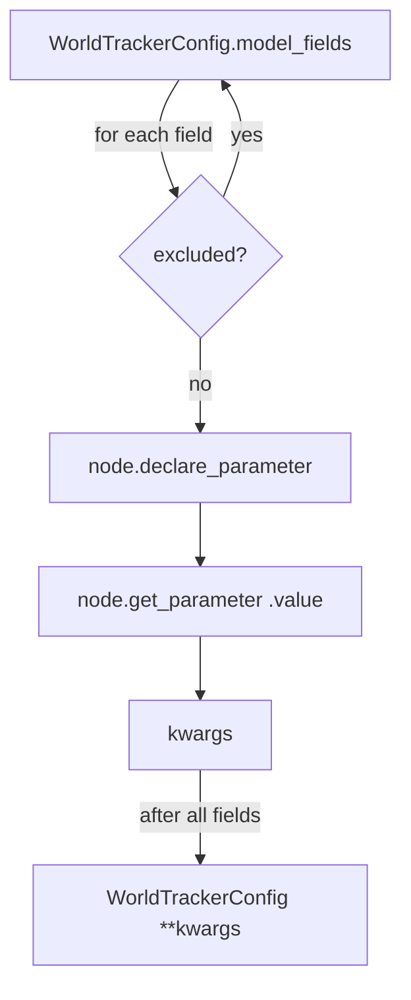

# `tracker_params.py` — ROS Parameters Without a Second Source of Truth

## The problem this file solves

`WorldTracker`'s tuning — how many frames before an object counts as
"confirmed," how far apart two observations can be and still be the same
object, how long a lost target survives before it's forgotten — lives in one
place: `WorldTrackerConfig`, a `pydantic.BaseModel` with about twenty fields,
each already carrying a documentation comment explaining what it does and why
its default is what it is.

A ROS node needs those same values to be **ROS parameters**: settable from a
launch file, inspectable with `ros2 param list`, changeable without a
rebuild. The naive way to get there is to hand-write a `declare_parameter`
call for every field, by name, in the node's `__init__`. That works — until
someone adds a field to `WorldTrackerConfig` and forgets the matching
`declare_parameter` line six months later. Now the dataclass says one thing
and the launch file can say another, silently.

`tracker_params.py` exists to make that class of bug structurally impossible:
it walks `WorldTrackerConfig`'s own field list at runtime and declares
whatever is there, rather than a hand-maintained copy of the list.

## The pattern, borrowed on purpose

This isn't a new idea in this codebase — it's a direct port of a pattern
`dome_nav` adopted for its own frontier-exploration tuning (`FrontierParams`,
declared via `dataclasses.fields()`). That earlier decision was itself a
response to the same drift bug happening for real: two independent
hand-transcriptions of the same dataclass had already fallen out of sync.

The one adaptation needed here: `WorldTrackerConfig` is a **pydantic**
model, not a `dataclasses.dataclass`, so introspection goes through
`WorldTrackerConfig.model_fields` instead of `dataclasses.fields()`. The
shape of the loop is otherwise identical — for every field, declare a ROS
parameter with the field's default, then read whatever the node actually has
(default or launch override) back into a constructor kwarg.

```python
def declare_tracker_config(node) -> WorldTrackerConfig:
    kwargs = {}
    for name, info in WorldTrackerConfig.model_fields.items():
        if name in EXCLUDED_TRACKER_FIELDS:
            continue
        default = "" if info.default is None else info.default
        node.declare_parameter(name, default)
        value = node.get_parameter(name).value
        kwargs[name] = (value or None) if info.default is None else value
    return WorldTrackerConfig(**kwargs)
```

## Why `node` is untyped

`declare_tracker_config` doesn't take an `rclpy.node.Node` — it takes
anything with `declare_parameter(name, default)` and `get_parameter(name)`.
That's a deliberate narrowing to exactly the two methods this function
needs, and it pays off directly in the test suite: `test_tracker_params.py`
exercises the whole declare/read/override round-trip against a ~10-line
`FakeNode`, with no `rclpy.init()`, no real ROS graph, no node teardown.
Compare that to testing the equivalent logic *inside* `SemanticMapNode.__init__`
— you'd need a live rclpy context just to check that a default round-trips
correctly.



## The `None`-default problem

ROS 2 parameters don't have a native "unset" value the way a Python
`Optional[X] = None` does — `declare_parameter` needs a concrete typed
default so it can infer the parameter's type. `class_profile_path` is
`str | None = None` in the config (no class-profile YAML by default). This
file bridges the gap with a small, explicit convention:

- **Declaring**: a `None` default becomes `""` (an empty string is a valid
  ROS string parameter; `None` is not).
- **Reading back**: an empty string reads back as `None` (`value or None`),
  so `WorldTrackerConfig` never sees the ROS-parameter workaround — it just
  sees `str | None`, exactly as declared.

This is the one place the function *can't* be fully generic over field
types — it has to special-case the `None`-default case — but it keeps that
special case to two lines instead of leaking ROS-parameter mechanics into
`tracker_config.py` itself.

## Why three fields are excluded

`EXCLUDED_TRACKER_FIELDS = {"class_profiles_inline", "fx", "fy"}`:

- **`class_profiles_inline`** is typed `list | None` — a list isn't a legal
  scalar ROS parameter type, and `class_profile_path` (a YAML file path)
  already gives launch files a way to supply class profiles. Declaring this
  one would need a serialization format ROS params don't have a good answer
  for.
- **`fx` / `fy`** are camera-intrinsic constants used only by
  `size_estimate.estimate_size_m()` — a code path this node doesn't call yet
  (no size estimation is wired into `SemanticMapNode` as of F33 T04).
  Declaring dead parameters would advertise tuning knobs that do nothing,
  which is worse than not declaring them at all.

Both exclusions are things to revisit, not permanent decisions: if a future
task wires size estimation into the node, `fx`/`fy` come off this list: the
loop shape doesn't need to change, just the excluded set.

## Observations

- **Single source of truth, verified by test.** `test_declares_every_field_except_excluded`
  asserts the declared parameter set equals `WorldTrackerConfig`'s field set
  minus the exclusions — so an added or removed field is caught by CI, not
  discovered live on the robot.
- **The `FakeNode` test double is small because the function's contract is
  small.** Two methods in, one config object out — that minimalism is what
  makes the fast, ROS-free test possible.
- **A future param-metadata upgrade is available but not taken.** `dome_nav`'s
  `FrontierParams` fields carry `ros_description`/`ros_important`/`ros_dynamic`
  metadata that feeds `ParameterDescriptor`s (so `ros2 param describe` is
  useful). `WorldTrackerConfig`'s pydantic `Field(description=...)` could
  supply the same thing here; it isn't wired up yet.
