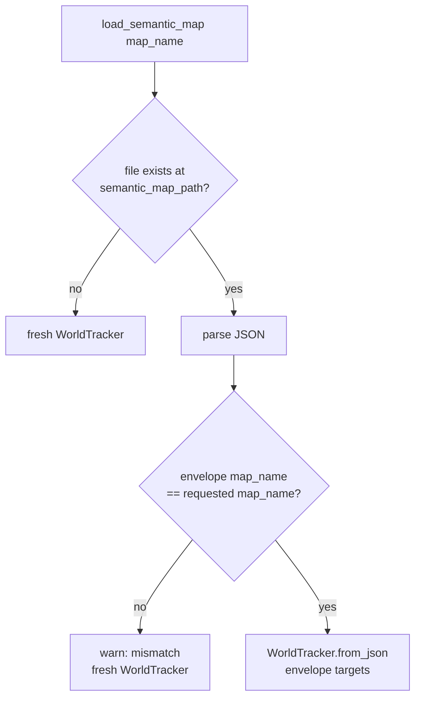

# `semantic_persistence.py` — Making a Semantic Map Outlive the Process That Built It

## Why this exists

Every other chapter so far describes a `WorldTracker` that lives entirely in
memory: build it, feed it detections, read back confirmed targets, done. But
`dome_nav`'s Mode B (navigate against a previously-built SLAM map, no live
exploration) has a real need this can't satisfy on its own: if the semantic
map — the "here's where the cans and cups are" knowledge — evaporates the
instant `SemanticMapNode` exits, Mode B can never say `nav go can` against
yesterday's map without re-running the entire exploration first. F33 T06's
job is closing that gap: **write the confirmed map to disk when the node
shuts down, read it back when the node starts up again** — matching against
the *specific* SLAM map currently in use, not just "whatever was saved
last."

## Reusing `WorldTracker`'s serialization, not replacing it

`WorldTracker` already has `to_json()`/`from_json()` (see `10-world_tracker.md`)
— a bare JSON array of confirmed-target dicts. This module doesn't
reimplement that; it wraps it:

```python
def save_semantic_map(tracker: WorldTracker, map_name: str) -> str:
    os.makedirs(semantic_map_dir(), exist_ok=True)
    path = semantic_map_path(map_name)
    envelope = {"map_name": map_name, "targets": json.loads(tracker.to_json())}
    pathlib.Path(path).write_text(json.dumps(envelope))
    return path
```

The one thing added is a thin **envelope**: `{"map_name": ..., "targets":
[...]}` instead of a bare list. Why not just extend `WorldTracker.to_json()`
itself to take a `map_name`? Because "which SLAM map does this data belong
to" isn't something the tracking core should know about — `WorldTracker` is
deliberately pure (no ROS, no filesystem, no notion of "map identity"), and
that boundary is worth protecting rather than blurring for one convenience.
Keeping the envelope in this file, one layer up, is what lets
`world_tracker.py` stay exactly as generic and dependency-free as it was
before this task.

## The key design question: how do you know a save matches a load?

The obvious approach — derive the file path from `map_name`
(`~/.dome/semantic_maps/<map_name>.json`) and treat "the file at that path"
as sufficient proof of identity — is *almost* right, and this module uses it
as the primary mechanism:

```python
def semantic_map_path(map_name: str) -> str:
    safe_name = re.sub(r"[^a-zA-Z0-9_-]", "_", map_name)
    return os.path.join(semantic_map_dir(), f"{safe_name}.json")
```

But the sanitizing regex — needed because a `map_name` could contain
characters that aren't safe in a filename — is **lossy**. `"room a"` and
`"room#a"` both sanitize to `room_a`, meaning two genuinely different map
names could collide on one file. If that ever happened silently, loading
`"room#a"` could hand back targets that were actually recorded for a
completely different physical space — exactly the kind of "guess and
proceed" failure the style guide calls out as worse than raising.

So the envelope's `map_name` field is a **second, independent check** — not
redundant with the path-based key, but a guard against exactly the case
where the path-based key lies:

```python
def load_semantic_map(map_name, config, warn_fn=lambda msg: None) -> WorldTracker:
    path = semantic_map_path(map_name)
    if not os.path.exists(path):
        return WorldTracker(config)

    raw = json.loads(pathlib.Path(path).read_text())
    saved_name = raw.get("map_name") if isinstance(raw, dict) else None
    if saved_name != map_name:
        warn_fn(f"... was saved for map_name={saved_name!r}, not {map_name!r} ...")
        return WorldTracker(config)

    return WorldTracker.from_json(json.dumps(raw["targets"]), config)
```



Every exit from this function is one of exactly two outcomes: a fresh
tracker (nothing to load, or something that doesn't check out as a matching
save), or a verified, matching load. There's no third path where mismatched
or unrecognized data gets merged in quietly.

`saved_name = raw.get("map_name") if isinstance(raw, dict) else None` is
doing double duty: it reads the envelope's key when there is one, *and* it's
what keeps a non-envelope file (a bare list, or literally anything else that
happens to parse as JSON) from crashing this function on `.get()` — such a
file simply produces `saved_name = None`, which can never equal a real
`map_name`, so it falls straight into the same warn-and-start-fresh path as
a genuine mismatch. One check handles both "wrong map" and "not a map at
all," rather than two separate branches for what is, from this function's
point of view, the same answer: *I can't trust this file, so I won't use
it.*

This deliberately doesn't attempt to *migrate* an old, pre-`map_name`-keying
file (`dome_vision_ros`'s predecessor node — see `13-semantic_map_node.md`
— persisted a bare array to an operator-chosen path). No file in that old
format has ever existed at a `map_name`-derived path, since that keying
scheme didn't exist before this task — so a migration path would be
speculative code for a case that can't occur yet, not a real one. The style
guide's requirement that persisted-format changes not silently break old
files is satisfied by the safe default here (never crash, never merge,
start fresh with a warning), not by teaching this function every past format
shape.

## Observations

- **This module has no ROS imports at all**, despite existing specifically
  to serve a ROS node's persistence need — `save_semantic_map`/
  `load_semantic_map` take a `WorldTracker`/`WorldTrackerConfig` and plain
  strings, nothing ROS-specific. `SemanticMapNode` is the only thing that
  turns `self.get_logger().warning` into the `warn_fn` these functions
  accept generically.
- **`semantic_map_dir()` isn't injectable** — it hardcodes
  `os.path.expanduser("~")`, matching `dome_nav`'s `explore_telemetry.
  telemetry_dir()` precedent exactly (same "patch `os.path.expanduser` /
  patch the whole function in tests" trade, not a constructor parameter).
  Consistency with that established pattern was chosen over introducing a
  different, arguably more testable, injectable-base-dir style for this one
  module.
- **The mismatch check can only ever fire on a genuine sanitization
  collision or manual file tampering** — under normal operation, the
  path-derived key and the envelope's own `map_name` always agree, because
  `save_semantic_map` writes both from the same value at the same time. The
  check exists for the crossed-wires case, not the common case, which is
  exactly when a lurking bug is most likely to be silent without it.
- **If a real need to read an old-format file ever shows up**, the fix is
  narrow: add one more branch recognizing that specific shape before the
  generic `saved_name is None` fallback catches it. The current code
  doesn't preclude that — it just doesn't speculatively build it first.
- **No file locking or atomic write.** `save_semantic_map` does a plain
  `Path.write_text()`, not a write-to-temp-then-rename — a save interrupted
  mid-write (process killed at just the wrong instant) could leave a
  truncated, unparseable JSON file behind. Low-probability (saves only
  happen once, at shutdown) but worth knowing if this ever needs to become
  more crash-safe.
