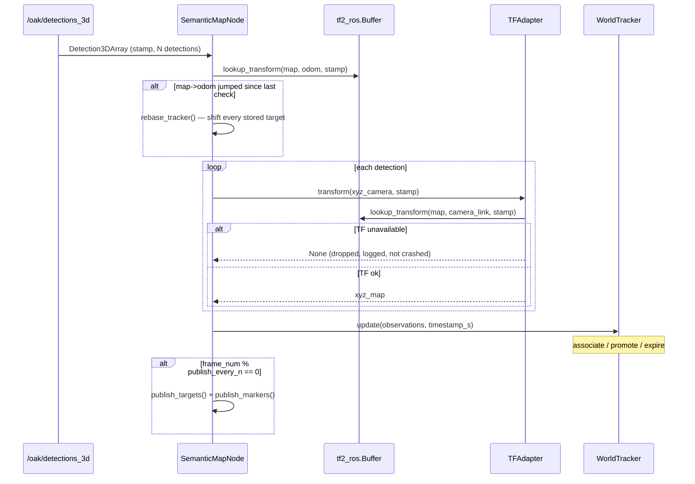

# `semantic_map_node.py` — Where Detections Become a Typed, Shareable Map

## What this node is for

Somewhere upstream, an OAK-D camera and a neural detector produce a stream of
`Detection3DArray` messages: "I saw a can at this point, in the camera's own
coordinate frame, right now." That's useful for exactly one consumer — the
node reading that topic — for exactly as long as the camera is currently
pointed at the object. It says nothing about where the can is *on the robot's
map*, and it forgets the can the instant the camera looks away.

`SemanticMapNode` is the seam where that ephemeral, camera-frame stream turns
into something durable and shareable: a set of *confirmed* objects, located
in the SLAM `map` frame, published as a typed message another package
(`dome_mission`) can subscribe to without knowing anything about cameras,
detectors, or tracking state machines. Three concerns are stacked here, each
doing one job:

1. **Geometry** — camera-frame point → map-frame point, at the moment the
   detection was taken (`tf_adapter.py`, used by this node).
2. **Stability under SLAM corrections** — when the SLAM backend revises its
   `map → odom` estimate (a "jump"), every already-recorded position needs
   the same correction applied, or the map silently drifts out of alignment
   with reality (`map_rebasing.py`, used by this node).
3. **Confirmation** — a single sighting isn't a fact; `min_frames` sightings
   over `min_time_s` seconds is treated as one (`world_tracker.py`, wrapped
   by this node).
4. **Continuity across restarts** — a semantic map is only useful for Mode B
   reuse if it survives the node that built it exiting
   (`semantic_persistence.py`, used by this node).

This file is the orchestration layer over all three, plus the ROS-specific
work of turning the result into a publishable, inspectable interface.

## The per-detection pipeline



Two things about this diagram are worth calling out because they're easy to
get backwards:

- **Re-basing happens before transforming**, not after. If a SLAM correction
  landed between the previous callback and this one, every *already-stored*
  target needs the correction applied first — otherwise the newly-transformed
  detection would be compared against stale, un-corrected positions during
  association, and `WorldTracker` would see a large spurious "jump" and
  create a duplicate target instead of matching the existing one.
- **A missing transform drops the detection, not the whole message.** Each
  detection in the array is transformed independently; one dropped point
  because of a momentary TF gap doesn't discard the others.

## Re-basing: the part that only exists because SLAM lies a little

`slam_toolbox` doesn't hold `map → odom` fixed. Every loop closure or scan
match nudges it — small drifts most of the time, occasional multi-centimeter
jumps when a loop closes. `odom` itself stays smooth (that's the whole point
of having an odometry frame), so the *detection* geometry
(`camera → odom`, effectively fixed by wheel/IMU odometry) doesn't move —
only where `odom` sits *within* `map` moves.

```python
def maybe_rebase(self, stamp) -> None:
    current = self.lookup_map_to_odom(stamp)
    if current is None:
        return
    if self.last_map_t_odom is not None and has_jumped(self.last_map_t_odom, current):
        delta = rebase_delta(self.last_map_t_odom, current)
        rebase_tracker(self.tracker, delta)
        self.get_logger().info("map->odom jumped; re-based stored targets.")
    self.last_map_t_odom = current
```

`last_map_t_odom is None` guards the very first call: there is nothing to
compare against yet, so the first observed `map → odom` becomes the
baseline rather than being treated as an infinite jump from an undefined
starting point. Every stored `ConfirmedTarget`'s position — not just new
detections — gets the same rigid-body correction (`rebase_tracker`, defined
in `map_rebasing.py`), so a can recorded five minutes ago and a can recorded
one second ago stay consistent with each other after a correction, even
though only one of them was actually re-observed.

## The publishing surface: four views of the same state

Once `WorldTracker.update()` returns, the node exposes what it knows through
four different channels, each serving a different consumer:

| Channel | Type | Consumer | Cadence |
|---|---|---|---|
| `/semantic/targets` | `SemanticTargetArray` | `dome_mission` (machine) | throttled |
| `/targets/markers` | `visualization_msgs/MarkerArray` | RViz (human) | throttled |
| `/targets/assoc_diag` | `std_msgs/String` (JSON) | offline debugging | every frame with data |
| `/describe_scene` | `std_srvs/Trigger` | voice/chat integration | on request |

### The typed map: `/semantic/targets`

This is the contract other packages build against. `SemanticTarget` is a
small, versioned message — `schema_version`, `target_id`, `label`, `pose`,
`observation_count`, `last_seen`, `track_ids` — deliberately typed instead of
the JSON blob an earlier iteration of this pipeline used, so a consumer like
`dome_mission`'s `label_resolver` can gate on `schema_version` and trust the
field types instead of parsing loosely-structured text.

```python
target.pose.position.x, target.pose.position.y, target.pose.position.z = t.xyz_world
target.pose.orientation.w = 1.0
```

The orientation is always identity. This isn't a placeholder waiting to be
filled in — `WorldTracker` only ever estimates a target's *position*; nothing
in the association or confirmation pipeline produces a facing direction for
an object. Publishing a fabricated yaw would be worse than publishing none,
since a consumer has no way to distinguish "real orientation" from "made up
to fill the field." The `pose.orientation` slot exists in the message for a
different consumer entirely: `dome_mission`'s go-to-target behavior reads
yaw as the heading the *robot* should arrive facing, not a claim about the
object — so identity is the honest value until a real orientation source
exists.

### Markers: three primitives per confirmed target

```python
sphere = make_marker(stamp, MAP_FRAME, "semantic_map", base_id, Marker.SPHERE)
...
text = make_marker(
    stamp, MAP_FRAME, "semantic_map", base_id + 1, Marker.TEXT_VIEW_FACING
)
...
line = make_marker(stamp, MAP_FRAME, "semantic_map", base_id + 2, Marker.LINE_STRIP)
```

Three markers share one `target_id * 3` numbering scheme (`base_id`,
`base_id + 1`, `base_id + 2`) so each target's sphere/label/leader-line
triplet gets stable, non-colliding RViz marker IDs across publish cycles —
RViz treats a marker ID as identity, so reusing a target's IDs on the next
publish updates the existing markers in place instead of accumulating
duplicates. Faint, unlabeled dots mark `potential_targets` (not yet
confirmed) in a separate namespace, so a viewer can watch an object
accumulate evidence before it "becomes real."

### Association diagnostics: unthrottled, and conditional

```python
if self.tracker.config.use_class_profiles and self.tracker.assoc_log:
    self.publish_assoc_diag()
```

This one bypasses the throttle deliberately — it's a debugging feed for
tuning the F38 PASA association cost function, and a tuning session wants
every frame's association decision, not a sampled subset. It's gated on
`use_class_profiles` because `assoc_log` is only populated when that feature
is active (see `world_tracker.py`); publishing an empty array every frame
when the feature is off would be pure overhead for no signal.

### Throttling: `publish_every_n`

```python
if self.frame_num % self.publish_every_n == 0:
    self.publish_targets()
    self.publish_markers()
```

Detections can arrive at camera framerate — publishing a full
`SemanticTargetArray` and a multi-marker `MarkerArray` on every single
callback is unnecessary work for consumers that only care about the
confirmed map, not the framerate. `publish_every_n` (a plain ROS int
parameter, default 5) exists purely to cap that publish rate; it's *not*
part of `WorldTrackerConfig` because it's a publishing-cadence concern, not
a tracking-behavior concern — changing it doesn't change what gets
confirmed, only how often the confirmed state is announced.

## Building the tracker: one call replaces a hand-written param block

```python
self.tracker = load_semantic_map(
    self.map_name, declare_tracker_config(self), self.get_logger().warning
)
```

Two adapters compose in this one line. `declare_tracker_config` (see
`11-tracker_params.md`) turns `WorldTrackerConfig`'s twenty-odd fields into
ROS parameters and builds the config object — that part hasn't changed since
T04. What's new is that the config no longer goes straight into a fresh
`WorldTracker()`; it goes through `load_semantic_map` first (see
`12-semantic_persistence.md`), which restores a previously-saved map for
`self.map_name` if one exists, or falls back to a fresh tracker (same as
before) if it doesn't. A new `map_name` ROS param (default `"unknown"`,
matching `explorer_manager_node`'s own default) is what selects *which*
saved map to restore — set by the launch file to the same value passed to
`slam_manager`'s `--map_name`, so the semantic map that comes back always
matches the SLAM map that's about to be (re)loaded.

## Persistence: save on shutdown, restore on startup

```python
def main() -> None:
    rclpy.init()
    node = SemanticMapNode()
    try:
        rclpy.spin(node, executor=rclpy.executors.MultiThreadedExecutor())
    except (KeyboardInterrupt, rclpy.executors.ExternalShutdownException):
        pass
    finally:
        node.save()
        node.destroy_node()
        if rclpy.ok():
            rclpy.shutdown()
```

**Why a `MultiThreadedExecutor`**: `TFAdapter` waits up to 0.2 s inside
`on_detections` for the detection stamp's transform to arrive. That only
works if TF messages keep being delivered during the wait, which needs a
second thread — the `TransformListener`'s reentrant callback group supplies
the permission, the multi-threaded executor supplies the thread. See
`08-tf_adapter.md`.

`node.save()` — a one-line wrapper around `semantic_persistence.save_semantic_map`
— runs in `main`'s `finally`, so it fires on a clean shutdown *and* on
`KeyboardInterrupt`/an external ROS shutdown request, not just the happy
path. This node is a plain `rclpy.node.Node`, not a `LifecycleNode` (the
`dome_vision_ros` predecessor this package was ported from was a
`LifecycleNode`, with `on_shutdown` as its natural save hook) — `main`'s
`finally` block is this file's equivalent hook, chosen deliberately over
adding lifecycle machinery this node doesn't otherwise need.

What actually gets saved and restored, and the specific decisions around
*matching* a save to a load (so a stale or wrong-map file is never silently
merged into the wrong session), belong to `semantic_persistence.py` itself —
see that chapter for the full story. From this file's point of view,
persistence is two one-line calls: load during `__init__`, save during
`main`'s teardown.

## `/describe_scene`: turning state into a sentence

```python
parts = [
    f"{n} {profiles[label].display_name or label if label in profiles else label}"
    for label, n in counts.items()
]
desc = parts[0] if len(parts) == 1 else ", ".join(parts[:-1]) + " and " + parts[-1]
```

A small English-list formatter: `"2 can"` alone, or `"2 can, 1 cup and 3 mug"`
for several labels. `display_name` (from an optional class profile) lets a
detector's raw label (e.g. `"cup_v2"`) surface as something a person would
actually say (`"cup"`), falling back to the raw label when no profile is
configured — this node works with or without the F38 PASA class-profiles
system turned on.

## Observations

- **The node has almost no logic of its own.** Every substantial decision
  (association, confirmation, geometry, re-basing math) lives in a module
  this file imports; `SemanticMapNode` is close to pure wiring plus
  ROS-message translation. That's by design — it keeps the pieces testable
  in isolation (as `test_map_rebasing.py`, `test_tf_adapter.py`, and
  `test_world_tracker.py` each do) and this file's own tests
  (`test_semantic_map_node.py`) focused on integration, not re-deriving unit
  coverage.
- **The observation-count grammar in `/describe_scene` doesn't distinguish
  singular from plural** (`"1 can"`, not `"1 can"` vs `"2 cans"`) — a minor,
  easy follow-up if the voice-integration consumer wants more natural
  phrasing.
- **Marker IDs assume `target_id * 3` never collides with `potential_targets`
  IDs**, since potentials publish into a separate namespace
  (`"semantic_map_potential"`) — namespaces, not raw IDs, are what keep RViz
  from conflating the two marker sets, which is worth knowing before adding
  a third marker category.
- **`publish_every_n` throttles `/semantic/targets` too, not just markers.**
  A consumer wanting the confirmed map at every detection tick (not just
  every Nth) would need `publish_every_n=1` — there's currently no way to
  decouple the marker cadence from the typed-message cadence.
- **Save-on-shutdown-only means no periodic autosave.** A hard crash (not a
  `KeyboardInterrupt` or clean ROS shutdown — an actual process kill) between
  saves loses everything confirmed since the last graceful exit. Nothing
  currently calls `save()` mid-session; a periodic timer calling it would be
  a small, low-risk addition if that turns out to matter in practice.
