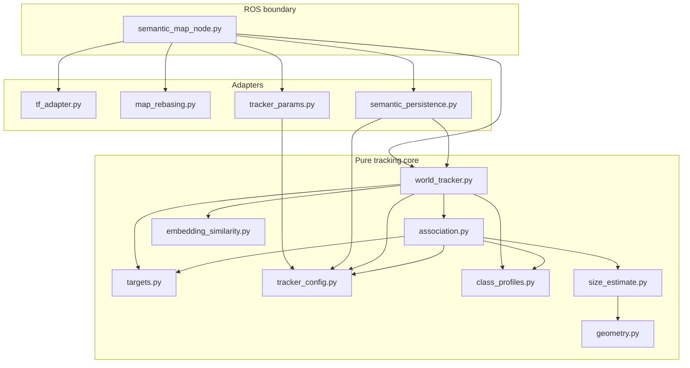
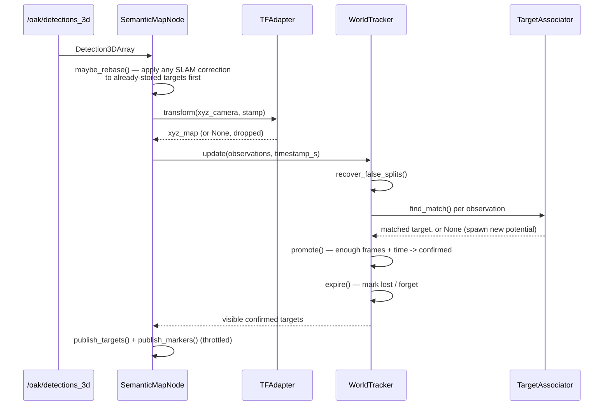

# `dome_semantic` — Theory of Operation

## What this package is

`dome_semantic` turns a stream of momentary, camera-frame object detections
into a small, stable, shareable **semantic map**: a set of confirmed objects
(cans, cups, whatever the detector recognizes) located in the SLAM `map`
frame, published as a typed ROS message. It is a *neutral* package —
depending only on TF and its own message package (`dome_semantic_msgs`) —
sitting between `dome_vision` (which owns the camera and the neural
detector) and `dome_mission` (which consumes confirmed targets for
go-to-label navigation). Neither of those two packages depends on the other;
`dome_semantic` is the thing that lets them not have to.

## The question this package answers, over and over

Every detection this package receives is really asking one question: *"Is
this the same object I already know about, or something new?"* Answering
that well, robustly, under real-world noise, is essentially the whole
package. Three kinds of noise make it hard:

- **Detector noise** — a single frame's detection could be a false positive,
  or slightly mis-positioned. One sighting isn't a fact.
- **Odometry drift** — the same physical object, re-observed a minute later,
  won't measure at *exactly* the same position, because the robot's own
  position estimate has drifted slightly in between.
- **SLAM corrections** — occasionally, the SLAM backend doesn't just drift
  gradually, it *jumps*: a loop closure revises `map → odom` all at once,
  and every previously-recorded position needs the same correction or the
  map falls out of alignment with itself.

Each of these has a dedicated answer in the chapters below: detector noise
is handled by requiring multiple confirmations before trusting a sighting
(`world_tracker.py`); odometry drift is handled by an association radius
wide enough to tolerate it (`association.py`); SLAM jumps are handled by
explicitly re-basing stored state when they're detected (`map_rebasing.py`).

## Architecture: three layers

1. **Pure tracking core** (`world_tracker.py`, `association.py`,
   `targets.py`, `tracker_config.py`, `class_profiles.py`,
   `embedding_similarity.py`, `size_estimate.py`, `geometry.py`) — no ROS
   imports anywhere in this layer. Everything here is plain Python and
   numpy, testable with `pytest` alone, no `rclpy.init()` required. This is
   almost the entire package by file count and by where the actual
   decisions get made.
2. **Adapters** (`tf_adapter.py`, `map_rebasing.py`, `tracker_params.py`,
   `semantic_persistence.py`) — the translation layer between "ROS/OS
   concepts" (TF frames, ROS parameters, the filesystem) and "plain values"
   (a 3-tuple, a `WorldTrackerConfig`, a `WorldTracker`). Each is
   independently testable by injecting a mock/fake, or a real temp
   directory, in place of the real ROS/OS resource it wraps.
3. **ROS boundary** (`semantic_map_node.py`) — the one place all of the
   above gets wired together into an actual `rclpy.node.Node`: subscribes to
   detections, drives the pure core, publishes the results, persists them.

This shape — pure core, thin adapters, one wiring node — is why the package
is testable at 127 passing tests with only a handful of them needing any
ROS machinery at all (mocked `tf2_ros.Buffer`/`TransformListener`, no real
ROS graph). It's also why a new tracking feature almost always means editing
the pure core, not the node: the node's job is to move data across the ROS
boundary, not to make tracking decisions.

## One detection, start to finish

Chapters 08–13 cover the ROS-facing half of this diagram in detail; chapters
04–07 and 10 cover the tracking-core half. (Persistence — chapter 12 —
happens at startup/shutdown, not per detection, so it doesn't appear in this
particular diagram; see `13-semantic_map_node.md`'s own diagram-free
"Persistence" section instead.)

## Reading order

The chapters build bottom-up — each one only depends on chapters before it:

| # | Chapter | Layer |
|---|---|---|
| 01 | [`geometry.py`](01-geometry.md) | pinhole camera math |
| 02 | [`size_estimate.py`](02-size_estimate.md) | pixel box → real-world size |
| 03 | [`embedding_similarity.py`](03-embedding_similarity.md) | appearance comparison |
| 04 | [`class_profiles.py`](04-class_profiles.md) | per-class physical priors |
| 05 | [`targets.py`](05-targets.md) | the potential/confirmed data model |
| 06 | [`tracker_config.py`](06-tracker_config.md) | the tuning single source of truth |
| 07 | [`association.py`](07-association.md) | baseline + PASA matching |
| 08 | [`tf_adapter.py`](08-tf_adapter.md) | camera → map point transform |
| 09 | [`map_rebasing.py`](09-map_rebasing.md) | SE(2) re-basing on SLAM jumps |
| 10 | [`world_tracker.py`](10-world_tracker.md) | the confirm/lose/forget state machine |
| 11 | [`tracker_params.py`](11-tracker_params.md) | config → ROS parameters |
| 12 | [`semantic_persistence.py`](12-semantic_persistence.md) | save/restore keyed to SLAM map identity |
| 13 | [`semantic_map_node.py`](13-semantic_map_node.md) | the ROS node that wires it all together |
| 14 | [`semantic.launch.py`](14-semantic_launch.md) | launching the node (optional no-SLAM `map→odom`) |

Reading 05 → 06 → 07 → 10 in sequence covers the tracking algorithm itself
end to end; 08, 09, 11, 12, 13, 14 cover how that algorithm gets fed from, and
exposed back to, a live ROS system.

## What's deliberately not in this package yet

A few things worth knowing about up front, each explained more fully in its
own chapter:

- **No size estimation is wired into the live node.** `size_estimate.py` and
  the PASA size-cost term in `association.py` are implemented and tested,
  but `SemanticMapNode` only receives already-3D `Detection3DArray`
  centroids — no pixel bounding box, no raw depth reading reaches this
  package yet (chapters 01, 02).
- **No appearance embeddings reach the live node either.**
  `WorldTracker.update_embedding()` and `combined_sim()` work, but nothing
  currently publishes embeddings for this node to subscribe to (chapter 03,
  chapter 10).
- **Object orientation is never estimated**, only position — every published
  `SemanticTarget.pose.orientation` is identity, by design, not omission
  (chapter 13).
- **Persistence has no periodic autosave** — `semantic_persistence.py`
  (chapter 12) saves on clean shutdown and restores on startup, but nothing
  saves mid-session, so a hard process kill loses everything confirmed since
  the last graceful exit.
