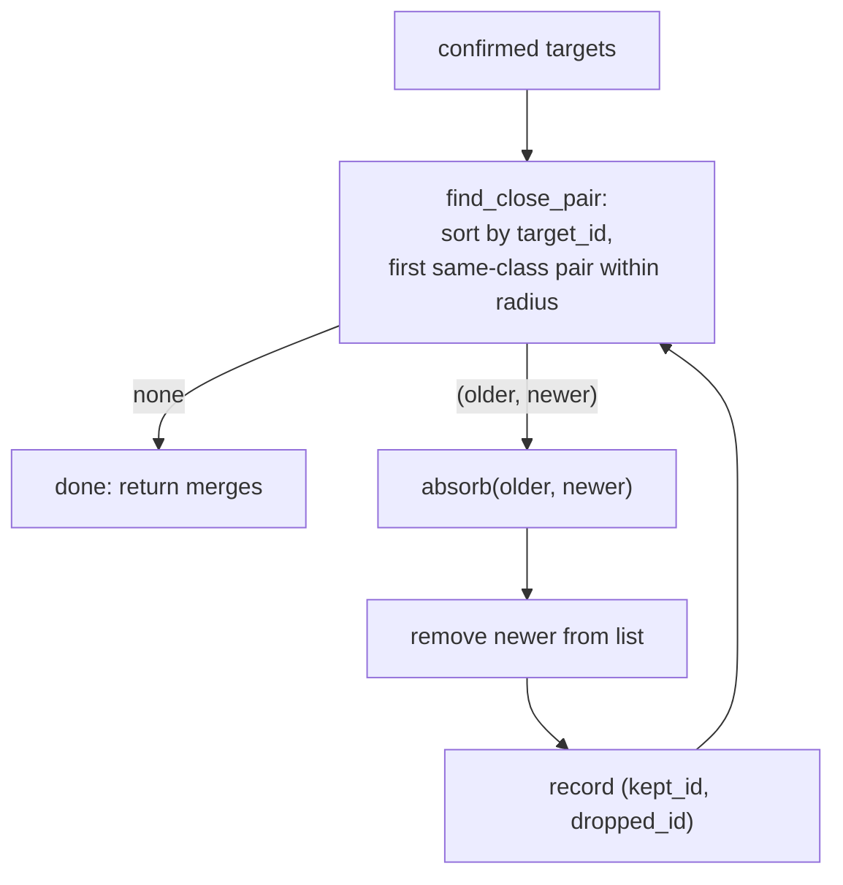

# `target_merge.py` — Folding Duplicate Targets Back Together

## The problem it solves

One physical can should be one confirmed target. Two things break that.

- **Scattered sightings.** SLAM pose error plus OAK-D depth error put
  re-sightings of an unmoved object 0.1–0.2 m apart on the 2026-11-13 drive
  bag. Two potentials can form from that scatter and each confirm on its
  own, giving two IDs a few centimetres apart.
- **Re-sighting after a gap.** A confirmed target goes lost while out of
  view. If the next sighting starts a new potential that confirms before
  it re-associates, the map has the can twice.

Association can't fix either case alone: it matches each observation
against what exists *at that moment*, and never revisits the result. This
module is the after-the-fact correction. `WorldTracker.update()` calls it
once per tick, right after promotion (`10-world_tracker.md`).

It's **pure**: no ROS, no config object, just a list of `ConfirmedTarget`s
and a radius table.

## The algorithm



```python
def merge_close_targets(confirmed, merge_radius_by_class):
    merges = []
    pair = find_close_pair(confirmed, merge_radius_by_class)
    while pair is not None:
        keep, drop = pair
        absorb(keep, drop)
        confirmed.remove(drop)
        merges.append((keep.target_id, drop.target_id))
        pair = find_close_pair(confirmed, merge_radius_by_class)
    return merges
```

### Why it repeats until nothing is in range

Merging moves the survivor to the weighted mean of the two positions. That
new position can now be within range of a third target that neither
original was close to. Re-scanning after every merge catches that chain.

This is a simple form of *agglomerative clustering* with a distance
threshold: repeatedly join the closest-enough pair until no pair qualifies.
The scan isn't the textbook "closest pair first"; it takes the first pair
in age order. With radii this small and targets this sparse, the order
rarely matters, and age order gives a deterministic survivor.

### Cost

Each scan is O(n²) over confirmed targets, and there are at most n − 1
merges, so the worst case is O(n³). In practice n is tens of targets and
almost every tick finds no pair, so a tick costs one O(n²) scan.

## Choosing the survivor

```python
by_age = sorted(confirmed, key=lambda t: t.target_id)
for i, older in enumerate(by_age):
    radius_m = merge_radius_by_class.get(older.canonical_class)
    ...
    for newer in by_age[i + 1 :]:
```

**The older target survives**, and "older" means the lower `target_id`.
IDs are issued in creation order, including across a save and restore
(`from_json` resumes `next_id` after the highest saved ID).

That choice is about consumers. `dome_mission` may already hold an ID; the
one that's been around longest is the one most likely to be referenced.

- **The radius comes from the class**, via the class profile's
  `merge_radius_m`. A class with no entry in the table never merges.
- **Different labels never merge**, even at the same point. A can and a cup
  double-labelled on one object stay two targets; that's a detector problem
  for `dome_vision`, and silently picking one label here would hide it.
- **Distance is full 3D** (`math.dist`), matching association's distance.

## What a merge combines

```python
def absorb(keep, drop):
    total = keep.observation_count + drop.observation_count
    keep.xyz_world = tuple(
        (k * keep.observation_count + d * drop.observation_count) / total
        for k, d in zip(keep.xyz_world, drop.xyz_world)
    )
    keep.observation_count = total
    keep.last_seen_s = max(keep.last_seen_s, drop.last_seen_s)
    keep.confirmed_at_s = min(keep.confirmed_at_s, drop.confirmed_at_s)
    keep.track_ids |= drop.track_ids
    keep.is_lost = keep.is_lost and drop.is_lost
```

- **Position is weighted by observation count.** A target built from 1,000
  sightings shouldn't be dragged halfway towards one built from 18. This is
  the same mean you'd get by pooling both targets' observations, as long
  as both positions are plain running means.
- **Freshness takes the later value, and age the earlier one.**
- **`is_lost` is an AND.** If either half is currently seen, the merged
  target is seen. That's the case that matters most: a lost can absorbing
  the visible newcomer that formed beside it comes back to life.

**Deliberately not combined**: the Welford position and size statistics,
`position_history` and the embedding stay the survivor's. Pooling Welford
state correctly needs the parallel-variance formula, and nothing downstream
reads those fields for a merged target yet. Not writing that code beats
writing it speculatively.

## How it fits with the radii

On the robot's shipped config the can's `merge_radius_m` equals its
`drift_tolerance_m` (both 0.40 m, guarded by a test). That's deliberate:

- **Anything close enough to re-associate is close enough to merge**, so
  the two mechanisms agree on what "the same can" means.
- **Two real cans closer than 0.4 m become one.** On the drive bag the two
  cans in one cluster were 0.44 m apart and stayed separate, but with very
  little margin.

## Observations

- **`confirmed.remove(drop)` relies on dataclass equality**, which compares
  every field except the embedding. It's correct because `target_id`
  differs between any two targets, but removing by identity
  (`is`) would say what's meant more directly.
- **First-pair-in-age-order isn't closest-pair-first.** For three targets in
  a tight cluster the result can depend on ID order. A closest-first
  variant would be more principled if clusters ever get dense.
- **No size check.** `dome_vision` F39 gated merges on compatible size
  distributions. Live size estimates don't reach this package yet, so that
  gate would have nothing to read; it's worth adding once they do.
- **Merged targets keep one side's variance**, so `is_converged` on a
  survivor reflects only its own history.
