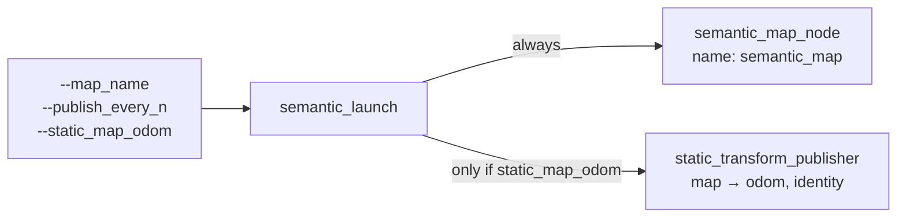

# `semantic.launch.py` — One Command for the Semantic Node

## What it does

`semantic.launch.py` starts `semantic_map_node` (chapter 13) and, if asked,
an identity `map→odom` static transform. It is the first launch file in this
package; before it, every hardware run took a bare `ros2 run` with `-p`
flags, typed from the right directory, plus a separate terminal for the
static transform.

It is deliberately **node-only**: no OAK-D, no SLAM, no Nav2. The full
perception + SLAM + explore stack (TF33.8 Part B) is meant to *include* this
file rather than duplicate its node definition.



## Why better_launch

The sibling packages (`dome_mission`, `dome_vision_ros`) already use
**better_launch**, where a launch file is a plain Python function and its
parameters *are* the launch arguments:

```python
@launch_this(ui=True)
def semantic_launch(
    map_name: str = "",
    publish_every_n: int = 5,
    static_map_odom: bool = False,
):
```

better_launch turns each parameter into a `click` option, using the type
annotation as the option's type. So `bl dome_semantic semantic.launch.py
--help` lists `--map_name TEXT`, `--publish_every_n INTEGER` and
`--static_map_odom BOOLEAN` without any `DeclareLaunchArgument` boilerplate.

**Consequence**: annotations must be types `click` can convert. That is why
the test file builds the click options itself (see *Testing* below).

## `map_name` is required

The node's own `map_name` parameter defaults to `"unknown"`. That default is
harmless for a unit test but **wrong for a real run**: persistence (chapter
12) keys the saved file on `map_name`, so every run that forgets the flag
would read and overwrite the same `unknown.json`, mixing targets from
different maps.

So the launch file refuses to start without it, the same convention
`mission_explore.launch.py` uses:

```python
if not map_name:
    raise ValueError(
        "map_name is required: bl dome_semantic semantic.launch.py --map_name <name>"
    )
```

This is *validation at the boundary*: the launch argument is user input, so
it is checked once here and the node trusts whatever arrives.

## The optional static transform

The no-SLAM bench setup needs something publishing `map→odom`, or every
detection fails its camera→`map` transform (chapter 08). An identity static
transform is the simplest stand-in:

```python
if static_map_odom:
    bl.node(
        "tf2_ros",
        "static_transform_publisher",
        name="map_odom_identity",
        cmd_args=["--frame-id", "map", "--child-frame-id", "odom"],
    )
```

Two things to know:

- **It skips re-basing** (chapter 09). With an identity `map→odom` the map
  never jumps, so this setup exercises detections → tracker → publishing,
  not the SLAM-correction path.
- **It must never run alongside SLAM.** `slam_toolbox` also publishes
  `map→odom`; two publishers of the same transform fight. That is why the
  flag defaults to off.

## The node itself

```python
bl.node(
    "dome_semantic",
    "semantic_map_node",
    name="semantic_map",
    params={"map_name": map_name, "publish_every_n": publish_every_n},
    ros_waittime=30.0,
)
```

- **`name="semantic_map"`** matches the name the node gives itself, so
  `ros2 param get /semantic_map ...` works the same either way it is started.
- **`ros_waittime=30.0`** is how long better_launch waits for the node to
  appear on the graph. Python node startup on the Pi is slow enough that
  the 3 s default is tight; the sibling launch files use 30 s too.
- Only two parameters are exposed. The ~20 tracker tuning parameters
  (chapter 11) keep their `WorldTrackerConfig` defaults; exposing them here
  would be speculative until a run shows one needs tuning.

## Testing

`@launch_this` *runs* the launch as soon as the module is executed, so
`test/test_semantic_launch.py` strips the decorator from the source, `exec`s
it, and swaps in a `MagicMock` for `BetterLaunch`. Calling the function then
records `bl.node(...)` calls instead of starting processes. The tests check:

- the click options build from the annotations;
- a missing `map_name` raises;
- the node receives the passed parameters;
- the static transform is absent by default and correct when enabled.

These need no ROS runtime, so they run in the plain test suite. A live run
on the robot (2026-10-23) confirmed the same wiring for real: node up with
the passed parameters, identity `map→odom` visible to `tf2_echo`, clean
shutdown with the map saved.

## Observations

1. **The decorator-stripping loader is duplicated** from `dome_vision_ros`'s
   `test_launch_args.py`. Fine for two packages; if a third needs it, it
   belongs in a shared test helper.
2. **No tracker tuning is exposed.** When a hardware run shows a threshold
   needs changing, add a `param_files` YAML argument rather than one launch
   argument per field.
3. **The string-matching strip** (`"@launch_this(ui=True)"`) breaks silently
   if the decorator's arguments change — the test would then *launch* the
   node. Matching the decorator by regex, or asserting it was removed, would
   make that fail loudly.
